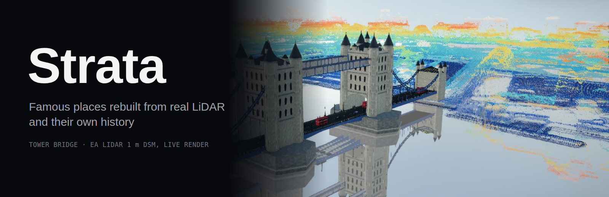
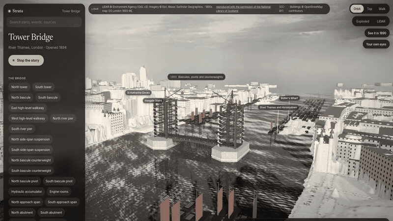
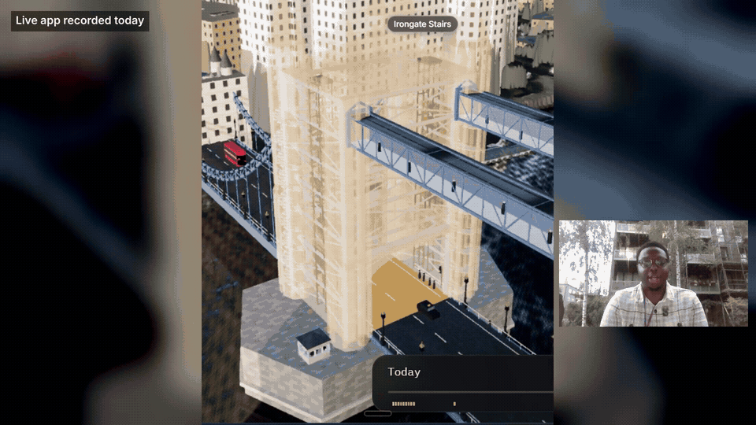
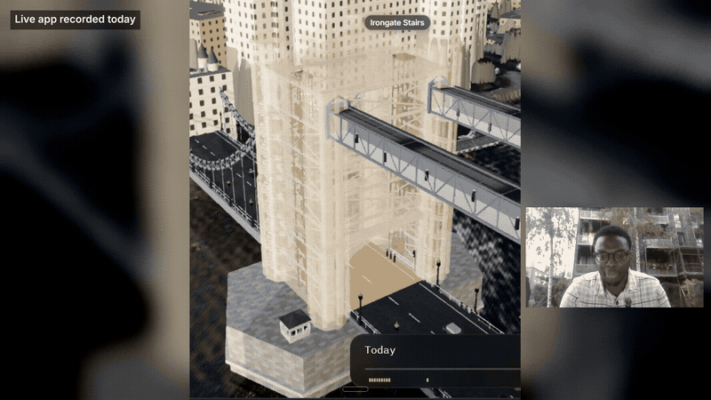
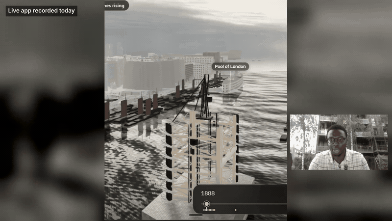
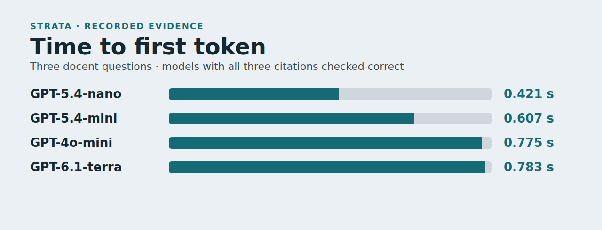
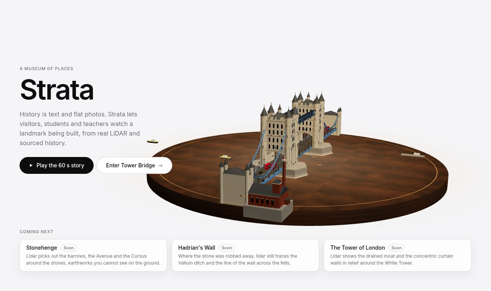
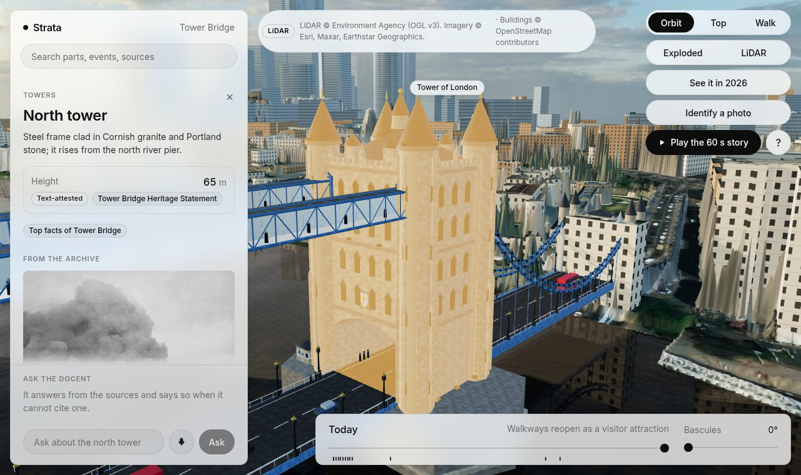
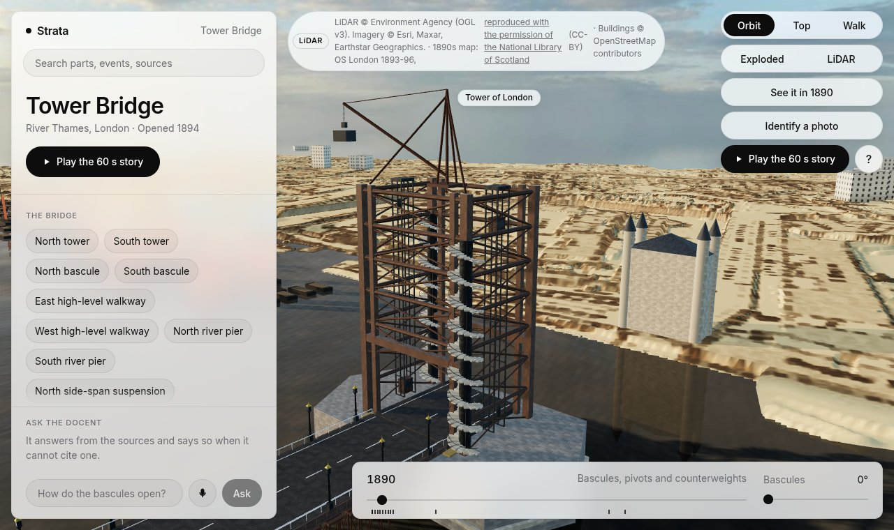

# Strata

[](web/package.json)
[](Makefile)
[](THIRD_PARTY_NOTICES.md)
[](#installation)

Visitors, students and teachers can read that Tower Bridge took eight years to build. Seeing how the piers, steel frames, cladding and hydraulics came together usually means piecing together separate maps, photographs and descriptions.

Strata is an interactive Tower Bridge exhibit built on surveyed ground. Scrub the years, lift the bascules and open the source behind each historical figure. In a three-question benchmark on the exhibit's original source set, the selected docent model produced its first token in a **0.421 s median**, with citations correct on all three questions. [Saved benchmark](docs/codex.md)

Built at DevDay Community Hackathon London on 1 November 2026 and finished the next day. Tower Bridge is the implemented exhibit. It uses Environment Agency LiDAR, archive material and a procedural reconstruction. The simulated counterweight extends about 9.8 m past the pier face at full lift, and phone checks were performed at phone viewport size on a cloud GPU.

**[Run the interactive demo](#installation)** · **[Watch the 90-second film](https://drive.google.com/file/d/1uNi3PW-jJgSrKpRLj1RA3SoMRMLxtWnQ/view?usp=sharing)**



<sub>Recorded from the real Strata exhibit. The bridge is a procedural reconstruction over surveyed terrain.</sub>

## How it works

1. **Operate the bridge.** The bascules are driven by a simulated hydraulic accumulator. Road signals, traffic and ships read the same state, so a lift changes how the rest of the scene moves (`web/src/scene/bridge/BasculeDrive.jsx`, `web/src/scene/bridge/hydraulics.js`).

   

2. **Scrub the build years.** The site works, towers and cladding appear in order from 1886 to 1894. Earlier views use bare earth and the period Ordnance Survey map, with archive photographs alongside the timeline (`web/src/scene/bridge/construction.jsx`, `web/src/scene/bareEarth.js`).

   

3. **Inspect the terrain and its sources.** Toggle the raw LiDAR point cloud or select a part to see its cited dimensions. The history graph serves parts, events and sources, and the validator guards numbers without a source (`web/src/scene/Terrain.jsx`, `scripts/validate.py`, `server/graph.py`).

   

## Results



The benchmark used the same questions about tower height, opening date and bascule motion on the original source set. Each answer was checked for source IDs and numeric provenance. The timing is a small sample of the tested model endpoints. [Full benchmark and follow-up](docs/codex.md)

| Model with 3/3 correct citations | Median first token |
| --- | --- |
| GPT-5.4-nano | **MEASURED** · 0.421 s |
| GPT-5.4-mini | **MEASURED** · 0.607 s |
| GPT-4o-mini | **MEASURED** · 0.775 s |
| GPT-6.1-terra | **MEASURED** · 0.783 s |

| Museum entrance | Sourced dimensions | Building in 1890 |
| --- | --- | --- |
|  |  |  |

## Installation

You need Git, Make, [uv](https://docs.astral.sh/uv/) and Node.js 20 or later.

```sh
git clone https://github.com/atiladeokegab/strata.git
cd strata
uv sync && (cd web && npm ci)  # Install the pinned API and web dependencies
make dev                      # Start the API at http://localhost:8090
(cd web && npm run dev)       # In a second terminal, open http://localhost:5173
```

The exhibit and keyword search run without a key. Set `OPENAI_API_KEY` in `.env` for the AI features. SurrealDB and Google 3D Tiles are optional.

## Documentation

[Place and source graph](data/places/tower-bridge.json) · [Docent implementation and benchmark](docs/codex.md) · [Data and third-party notices](THIRD_PARTY_NOTICES.md).

## Contact

Open an [issue](https://github.com/atiladeokegab/strata/issues) with the exhibit year and part when reporting a problem. Atilade Oke ([GitHub](https://github.com/atiladeokegab), [LinkedIn](https://www.linkedin.com/in/atiladeoke/)).

## Contributing

Run `make smoke` and `uv run python scripts/validate.py`. Cite a source and mark each new historical quantity as text-attested, measured or inferred.

## Citation

```bibtex
@software{strata_2026,
  title = {Strata: Tower Bridge},
  author = {Oke, Atilade},
  year = {2026},
  url = {https://github.com/atiladeokegab/strata}
}
```

## License

See [THIRD_PARTY_NOTICES.md](THIRD_PARTY_NOTICES.md) for the adapted Mechanica code (MIT) and material-specific terms. Environment Agency 1 m LiDAR is OGL v3, OpenStreetMap is ODbL, and the historic map is reproduced with permission from the National Library of Scotland (CC BY). The archive photographs and sample images carry individual credits and licences. Contact the maintainer for terms on the remaining project code.
