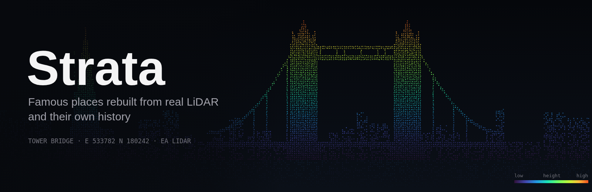
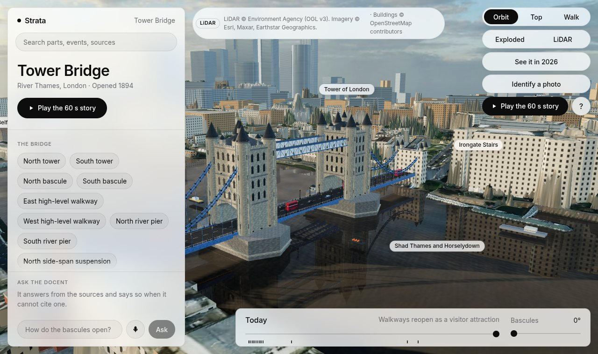
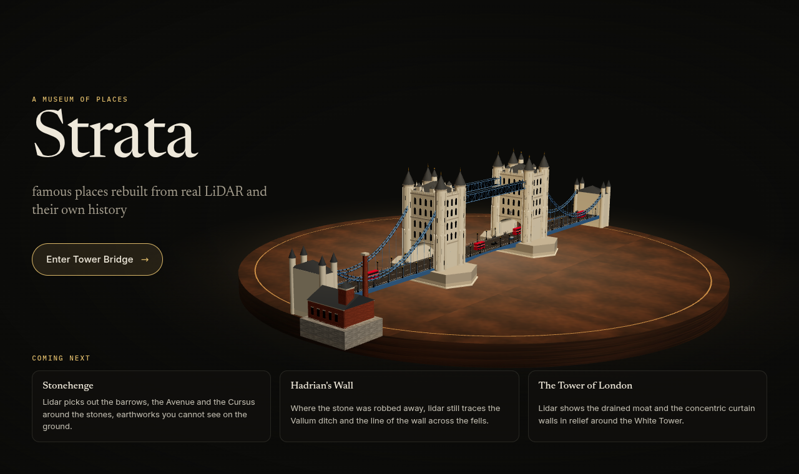
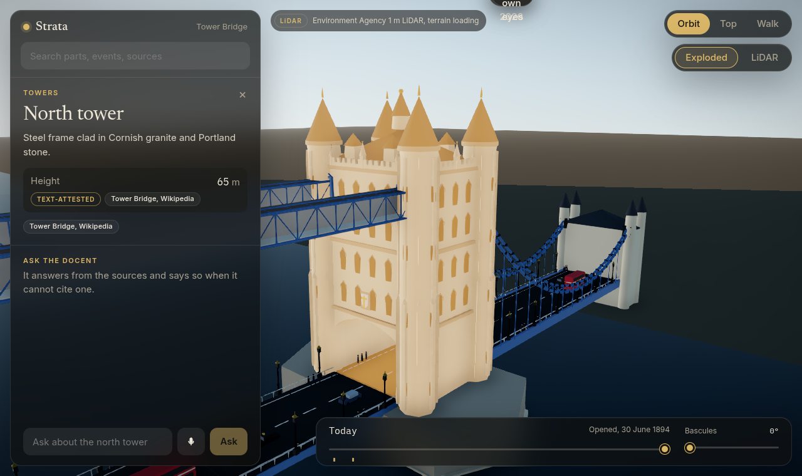
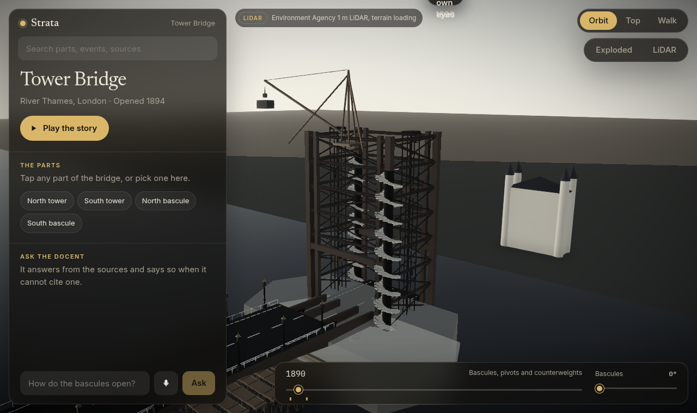
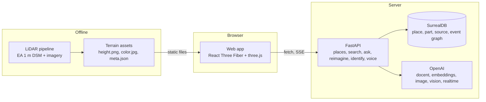

<p align="center">
  
</p>

<p align="center">
  <a href="https://platform.openai.com/"></a>
  <a href="https://threejs.org/"></a>
  <a href="https://surrealdb.com/"></a>
  <a href="https://fastapi.tiangolo.com/"></a>
  <a href="https://environment.data.gov.uk/survey"></a>
  <a href="https://www.nationalarchives.gov.uk/doc/open-government-licence/version/3/"></a>
</p>

<h3 align="center">History is text and flat photos. You can't watch a landmark being built.</h3>

<p align="center">Strata rebuilds famous places from real LiDAR and their own sourced history, for visitors, students and teachers.</p>

<p align="center">
  <a href="https://strata-901257379404.europe-west2.run.app"><b>Open the live demo</b></a>
</p>

<p align="center">
  
</p>

<!-- TODO(demo): record the demo and drop it at docs/img/demo.gif, then uncomment.
<p align="center"></p>
-->

## Who it's for

Visitors, students and teachers who want to see how a landmark was built and how it works, not just read about it.

You can read that Tower Bridge took eight years to build, that its towers stand 65 m tall and that its bascules lift to 86 degrees. Strata lets you watch it: the piers going in, the steel frames rising, the stone going on, and the leaves lifting on the hydraulics that still power them. Every number on screen has a source, and the docent refuses what it can't cite.

First exhibit: **Tower Bridge**, London.

## Try it

**Live:** [strata-901257379404.europe-west2.run.app](https://strata-901257379404.europe-west2.run.app)

1. You land in a museum of places, with Tower Bridge turning under a spotlight. Press **Enter Tower Bridge**.
2. Press **Play the story** for the guided tour from 1886 to today. Add `?tour=1` to the link to start it straight away.
3. Drag to orbit and scroll to zoom, or switch to **Top** or **Walk** at the top right. Press **LiDAR** to see the ground as the raw Environment Agency point cloud, coloured by height.
4. Tap any part of the bridge, or pick one from the panel. The camera flies to it and the inspector shows each figure with its source and status.
5. Press **Exploded** to take the bridge apart and look inside the towers. Raise the **Bascules**, or drag a leaf, and watch the traffic stop at the gates and the ship downstream wait, then sail through.
6. Drag the timeline. The site works, rigs, barges and scaffold come and go stage by stage, real archive photographs from 1892 to 1940 appear for the year, and the ticks on the timeline open the story of each event.
7. Ask the docent, for example "How do the bascules open?", by typing or by voice.
8. Press **See it in** a year to have the view repainted as a period photograph, or upload your own photo of the bridge to have its parts named.

<table>
  <tr>
    <td width="33%"></td>
    <td width="33%"></td>
    <td width="33%"></td>
  </tr>
  <tr>
    <td align="center">A museum of places</td>
    <td align="center">Every figure has a source and a status</td>
    <td align="center">1890: the steel frames rise</td>
  </tr>
</table>

## What we built today

Everything in this repo was built at the DevDay Community Hackathon London on 1 November 2026, by one person working with a team of AI coding agents.

- **The terrain:** 1.5 km square of real Environment Agency 1 m LiDAR around the bridge, draped with aerial imagery, with a raw point-cloud view and the Thames at its surveyed level.
- **The app shell:** a museum-of-places Home stage, a full-screen 3D stage, a calm glass panel with the place card, search, part inspector and docent, orbit, top-down and walk views, fly-to-part, a phone move pad, and a timeline with story markers and sourced story cards.
- **The bridge:** a procedural Tower Bridge whose meshes are named by part id, from the towers' parapets, pinnacles and turrets down to the bascule girders, chains and anchor plates. It explodes into its parts, and its cladding x-rays to show the steel frame.
- **The interiors:** the Victorian stairs and hydraulic lifts inside the towers.
- **The machine:** bascules driven by a weighted-accumulator hydraulic simulation, with a live readout, power flowing along the hydraulic mains, a drag handle on each leaf that works the operator's lever, road traffic held by gates and signals at each bascule, the 1894 hydraulic engine house on the south bank, and its 1976 electro-hydraulic changeover.
- **The river:** the ship changes with the year: a three-masted barque from 1894, a steam tug towing a lighter from 1930, a motor coaster from 1970, and a Thames Clipper from 1999. Each waits downstream until the leaves are up, then sails through. A Clipper is low enough to pass under the closed deck, and era small craft yield to the big vessel. Before 1950, lighters and sailing barges lie moored in tiers along the Pool of London.
- **The construction stages and works:** the bridge rises from 1886 to 1894 with the period's site works around it: staging, a piling rig, barges, derricks, centring, cradles and scaffold.
- **Top view:** part callouts with leader lines, a 50 m scale bar, a north arrow and the bascules' swing envelopes.
- **The look:** a Poly Haven HDRI sky and matched sun, fitted soft shadows, haze, and a post stack with a period colour grade by year.
- **The history:** 24 bridge parts, 9 places around it pinned on the ground by the years they stood, 14 sourced events, and the people behind it, held in a SurrealDB graph served by `GET /api/places/{id}`, with a validator (`scripts/validate.py`) and poison tests that fail any number without a source.
- **The streaming docent:** `POST /api/ask`. Answers stream into the chat with citation chips for every fact, and it refuses questions it can't source.
- **Search:** `GET /api/search`, semantic search over parts, events and sources.
- **Reimagine:** "See it in" a year repaints the 3D view as a period photograph, with cached views for 1894, 1944 and today in a Then and now strip.
- **Identify:** upload a real photo of the bridge, or pick one of three samples, to have its parts named and boxed, and to see where the photographer stood.
- **Voice:** talk to the guide out loud.
- **From the archive:** 10 real photographs of the bridge from 1892 to 1940, matched to the year on the timeline and credited on screen.
- **The tour:** a guided story through the whole timeline, cut to fit the 90-second film.
- **The deploy:** a multi-stage Docker build, live on Cloud Run.

## OpenAI models

| Feature | Model | What it does |
|---|---|---|
| Docent | `gpt-5.4-nano` | Streams answers from at most four retrieved facts, cites each one, and refuses anything unsourced. Chosen by a benchmark: 3 of 3 answers cited correctly and the fastest first token, 0.42 s median (see [docs/codex.md](docs/codex.md)). |
| Search | `text-embedding-3-small` | Embeds the exhibit's parts, events and sources once at startup, for semantic search. |
| Reimagine | `gpt-image-2.5-flare` | Repaints a capture of the 3D view as a photograph of the chosen year. |
| Identify | `gpt-6.1-terra` and `gpt-6.1-sol` | Names the parts in a real photo. The fast model and the careful one race, and the fast answer wins when its camera agrees with the towers. |
| Voice | `gpt-realtime-2.1` | A spoken conversation with the guide. |

## Use of Codex

Two of the agents that built Strata ran on Codex. One concrete example: Atlas, on Codex, built the history graph and its validator. Every mocked test passed, but its first run against a live SurrealDB caught a `RELATE` syntax error the mocks had missed. Codex fixed it, then checked exact readback of Unicode, quotes and colons, and made reseeding idempotent.

The full log, with session ids, commits and the docent model benchmark, is in [docs/codex.md](docs/codex.md).

## Data is law

Every number in Strata has a source and a status:

| Status | Meaning |
|---|---|
| `text-attested` | Stated in a cited source |
| `measured` | Measured by us from data, such as the LiDAR surface |
| `inferred` | Derived from other sourced figures, with the reasoning recorded |

A number without a source fails validation. The docent follows the same law: no citation, no answer.

This idea comes straight from **[Mechanica](https://github.com/Caleb0796/mechanica)** (MIT), which rebuilds historic machines under the rule that data is law and mechanisms run on simulated state. Strata takes that rule out of the workshop and onto a real map.

## How it's built



- **Scene frame:** metres, origin at the centre of the bridge deck at road level, x east, y up, z south. Measured from the LiDAR, the origin sits at OSGB36 E 533670.3, N 180265.1, and the bridge axis runs 20.95 degrees off grid north.
- **Part ids are the shared key.** Scene meshes are named by part id, and clicking a mesh selects that part in the inspector and the docent.
- **Place data** follows one shape everywhere: `{id, name, location, parts, events, sources}`, served from SurrealDB when `SURREAL_URL` is set, with the validated JSON file as the fallback.
- **Mechanisms run on state, not keyframes.** The bascule angle comes from the hydraulic simulation, and the traffic and the ship read it.

## Coming next

- The surrounding city: buildings and Google 3D tiles. The slots and the on-screen Google credit are in the app.
- Historic maps draped on the ground before 1950. The 1890s OS Town Plan is already mosaicked onto the LiDAR grid.
- More places. The Home stage already lists Stonehenge, Hadrian's Wall and the Tower of London.

## Setup

You need [uv](https://docs.astral.sh/uv/) and Node 20 or later.

```bash
uv sync
(cd web && npm install)

make dev                 # API on http://localhost:8090
(cd web && npm run dev)  # web app on http://localhost:5173, proxies /api to :8090
```

Everything except the AI features runs with no keys. For those, put `OPENAI_API_KEY` in `.env`, which is gitignored. Without it the docent refuses and search falls back to keywords.

Optional:

- **SurrealDB graph:** set `SURREAL_URL` (and `SURREAL_USER`, `SURREAL_PASS` if needed), then seed it with `uv run python -m server.graph`. Without it the API serves the validated JSON.
- **Google 3D tiles:** set `GOOGLE_TILES_KEY`.

Checks: `make smoke` runs the Python tests, and `uv run python scripts/validate.py` validates the place data. `make web` builds the web app, and `make deploy` deploys to Cloud Run.

## Credits

Existing code, data and ideas this project stands on. File-by-file detail and licence texts are in [THIRD_PARTY_NOTICES.md](THIRD_PARTY_NOTICES.md).

- **[Mechanica](https://github.com/Caleb0796/mechanica)** (MIT, commit `27b5f8b`): the idea that data is law, sourced numbers with a status, and mechanisms driven by simulated state. Adapted code: the ACES grade and haze, the procedural PBR textures, the museum Home stage, the tour's part close-up, the bascule drag handle, and the docent's sourcing and refusal contract.
- **Environment Agency LiDAR:** LiDAR Composite DSM, 1 m. © Environment Agency copyright and/or database right. [Open Government Licence v3.0](https://www.nationalarchives.gov.uk/doc/open-government-licence/version/3/). For the terrain and the point cloud.
- **OpenStreetMap:** © OpenStreetMap contributors, [Open Database Licence (ODbL)](https://opendatacommons.org/licenses/odbl/), for the surrounding buildings, which are coming next.
- **Google Photorealistic 3D Tiles:** © Google and its data providers. The attribution shows on screen whenever the tiles do. The tiles layer is coming next.
- **Aerial imagery:** Esri World Imagery, © Esri, Maxar, Earthstar Geographics and the GIS User Community, under the Esri World Imagery terms of use.
- **Sky and light:** [Poly Haven](https://polyhaven.com/a/evening_road_01_puresky) `evening_road_01_puresky`, CC0.
- **Historic map:** OS London Town Plan, five feet to the mile, 1893 to 1896. Reproduced with the permission of the [National Library of Scotland](https://maps.nls.uk/) (CC BY).
- **Archive photographs:** 10 photographs from Wikimedia Commons (public domain, CC0 and CC BY-SA 3.0), credited on screen and in THIRD_PARTY_NOTICES.md.
- **History and dimensions:** each figure cites its own source in `data/places/tower-bridge.json`.
- **3D:** [three.js](https://threejs.org/) (MIT), [React Three Fiber](https://github.com/pmndrs/react-three-fiber) (MIT) and [drei](https://github.com/pmndrs/drei) (MIT).
- **Web and server:** [React](https://react.dev/), [Vite](https://vite.dev/), [zustand](https://github.com/pmndrs/zustand), [FastAPI](https://fastapi.tiangolo.com/), [SurrealDB](https://surrealdb.com/) and the [OpenAI Python SDK](https://github.com/openai/openai-python).
- **Banner and screenshots:** headless renders of the live app. The banner's title is laid over the render in `docs/img/banner.html`.

---

<p align="center">Built at the DevDay Community Hackathon London, 1 November 2026.</p>
