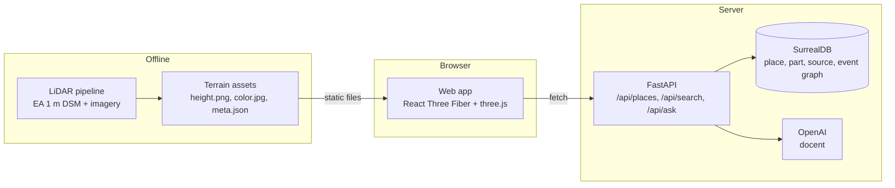

<p align="center">
  
</p>

<p align="center">
  <a href="https://platform.openai.com/"></a>
  <a href="https://threejs.org/"></a>
  <a href="https://platform.openai.com/docs/guides/images"></a>
  <a href="https://platform.openai.com/docs/guides/realtime"></a>
  <a href="https://surrealdb.com/"></a>
  <a href="https://fastapi.tiangolo.com/"></a>
  <a href="https://environment.data.gov.uk/survey"></a>
  <a href="https://www.nationalarchives.gov.uk/doc/open-government-licence/version/3/"></a>
</p>

<h3 align="center">History is text and flat photos. You can't watch a landmark being built.</h3>

<p align="center">Strata rebuilds famous places from real LiDAR and their own sourced history, for visitors, students and teachers.</p>

<!-- TODO(demo): record the demo and drop it at docs/img/demo.gif, then uncomment.
<p align="center"></p>
-->

## Who it's for

Visitors, students and teachers who want to see how a landmark was built and how it works, not just read about it.

## The problem

You can read about how Tower Bridge was built. You can't watch it. The history of a place comes as text and flat photos.

The books give you numbers: 65 m towers, bascules that lift to 86 degrees, eight years of work from 1886 to 1894. What they can't give you is the place itself, in three dimensions, changing over time, with the machine inside it moving.

Strata rebuilds a famous place from the ground up. The ground is real: the Environment Agency's 1 m LiDAR survey of London. The structure on it is built from sourced part data. Its history lives in a graph you can scrub through, and a docent answers your questions only with numbers it can cite.

First exhibit: **Tower Bridge**, with the Tower of London, the Thames and Shad Thames around it.

## Try it

**Live demo:** [strata-901257379404.europe-west2.run.app](https://strata-901257379404.europe-west2.run.app)

1. Open the link. You land in a museum of places, with Tower Bridge turning under a spotlight. Enter it.
2. Press **Play the story** for the guided tour, or add `?tour=1` to the link to start it straight away.
3. Drag to orbit and scroll to zoom, or switch to top-down or walk.
4. Click any part of the bridge. The camera flies to it and the inspector shows the source and status of every figure.
5. Explode the bridge, then raise the bascules and watch the live hydraulics readout. A barque downstream waits until the leaves are up, then sails through.
6. Drag the timeline from 1886 to today. The site works, piling rigs, barges and scaffold come and go stage by stage, and the light takes on the period's grade.
7. Press **See it in** a year to have the view repainted as a period photograph.
8. Upload your own photo of the bridge. Strata names the parts in it and places you where you stood.

## What you can do

- **Fly over real LiDAR.** Orbit the bridge, drop to a top-down view of the topography, or walk the deck.
- **Take the bridge apart.** Explode it into towers, bascules, high walkways, suspension chains, piers and counterweights, and click any part to read what it is and where every figure comes from.
- **Open the bascules.** The leaves lift on a simulated hydraulic system, driven by state, not keyframes.
- **Scrub 1886 to today.** Watch the piers go in, the towers rise and the place around them change, with historic maps draped on the ground before 1950.
- **Ask the docent.** It cites every number it gives you, and refuses what it can't source.

### On `main` today

- **Home:** a museum-of-places landing stage.
- **The app:** a full-screen 3D stage with a calm glass panel (place card, search, part inspector, docent chat), orbit, top-down and walk views, fly-to-part, a timeline, bascule and exploded controls, and the guided story.
- **The bridge:** a procedural Tower Bridge with every mesh named by its part id: towers with their parapets, pinnacles and turrets, bascules, high walkways, chains and anchorages, lamps and road markings, and the 1894 hydraulic power house on the south bank. The bascules run on a weighted-accumulator hydraulic simulation, and construction rises from 1886 to 1894 with the period's site works around it.
- **The look:** physical sky and sun, fitted soft shadows, haze, and a post stack with a period grade by year.
- **Reimagine:** `POST /api/reimagine` repaints a capture of the 3D view as a photograph of the chosen year with OpenAI's image model, plus instant cached views for 1894, 1944 and today in a Then and now strip.
- **Identify:** `POST /api/identify` names the parts in a real photo, boxes them and places the photographer. A fast model and a careful model race, and the fast answer wins when it agrees with the towers.
- **Voice:** `POST /api/voice/session` opens a spoken conversation through OpenAI's realtime model.
- **Place data:** Tower Bridge parts with sourced dimensions and dated events at `GET /api/places/{id}`. Search runs over this data in the browser until `/api/search` lands.
- **Deploy:** a multi-stage Dockerfile that builds the web app, and `make deploy` to Cloud Run.

### Coming next

- LiDAR terrain and the point-cloud view. The ground and river are placeholders until the terrain assets land.
- Historic maps draped on the ground before 1950.
- The SurrealDB history graph.
- The docent and search endpoints, `/api/ask` and `/api/search`. The chat already streams answers with citations and handles refusals; it waits for the endpoint.

## What we built today

Everything in this repo was built at the DevDay Community Hackathon London on 1 November 2026, by one person working with a team of AI coding agents: the LiDAR terrain pipeline, the procedural bridge, the hydraulic simulation, the history graph and its data, the API and docent, and the web app.

## Use of Codex

<!-- TODO(codex): one concrete example from docs/codex.md once it lands. -->
Two of the agents that built Strata ran on Codex. Their log of concrete Codex moments, with session ids, is in [docs/codex.md](docs/codex.md).

## Data is law

Every number in Strata has a source and a status:

| Status | Meaning |
|---|---|
| `text-attested` | Stated in a cited source |
| `measured` | Measured by us from data, such as the LiDAR surface |
| `inferred` | Derived from other sourced figures, with the reasoning recorded |

A number without a source fails validation. The docent follows the same law: no citation, no answer.

This idea comes straight from **[Mechanica](https://github.com/Caleb0796/mechanica)** (MIT), which rebuilds historic machines under the rule that data is law and mechanisms run on simulated state. Strata takes that rule out of the workshop and onto a real map.

## How it's built



- **Scene frame:** metres, origin at the centre of the bridge deck at road level, x east, y up, z south. The origin sits at OSGB36 E 533782, N 180242.
- **Part ids are the shared key.** Scene meshes are named by part id, and clicking a mesh selects that part in the inspector and the docent.
- **Place data** follows one shape everywhere: `{id, name, location, parts, events, sources}`, served from SurrealDB once seeded, with the JSON file as the fallback.

## Credits

Existing code, data and ideas this project stands on:

- **Terrain height:** Environment Agency LiDAR Composite DSM, 1 m. © Environment Agency copyright and/or database right. Licensed under the [Open Government Licence v3.0](https://www.nationalarchives.gov.uk/doc/open-government-licence/version/3/).
- **Imagery and historic maps:** credited here as the terrain builder records them in `web/public/terrain/tower-bridge/meta.json`.
- **History and dimensions:** each figure cites its own source in `data/places/tower-bridge.json`.
- **Idea and code:** [Mechanica](https://github.com/Caleb0796/mechanica), MIT licence: data is law, sourced numbers with a status, mechanisms driven by simulated state. Adapted from Mechanica (commit `27b5f8b`): the scene look (light rig, ACES grade, haze), the procedural PBR textures, the museum Home stage, and the tour's part close-up. The file-by-file list and Mechanica's licence are in [THIRD_PARTY_NOTICES.md](THIRD_PARTY_NOTICES.md).
- **3D:** [three.js](https://threejs.org/) (MIT), [React Three Fiber](https://github.com/pmndrs/react-three-fiber) (MIT) and [drei](https://github.com/pmndrs/drei) (MIT).
- **Web and server:** [React](https://react.dev/), [Vite](https://vite.dev/), [zustand](https://github.com/pmndrs/zustand), [FastAPI](https://fastapi.tiangolo.com/) and [SurrealDB](https://surrealdb.com/).
- **Banner:** an illustration drawn in code (`docs/img/banner.html`), not a render of the survey data.

## Setup

You need [uv](https://docs.astral.sh/uv/) and Node 20 or later.

```bash
uv sync
(cd web && npm install)

make dev                 # API on http://localhost:8090
(cd web && npm run dev)  # web app on http://localhost:5173, proxies /api to :8090
```

The docent needs an OpenAI key. Put it in `.env` as `OPENAI_API_KEY`; `.env` is gitignored.

Run the checks with `make smoke`.

---

<p align="center">Built at the DevDay Community Hackathon London, 1 November 2026.</p>
